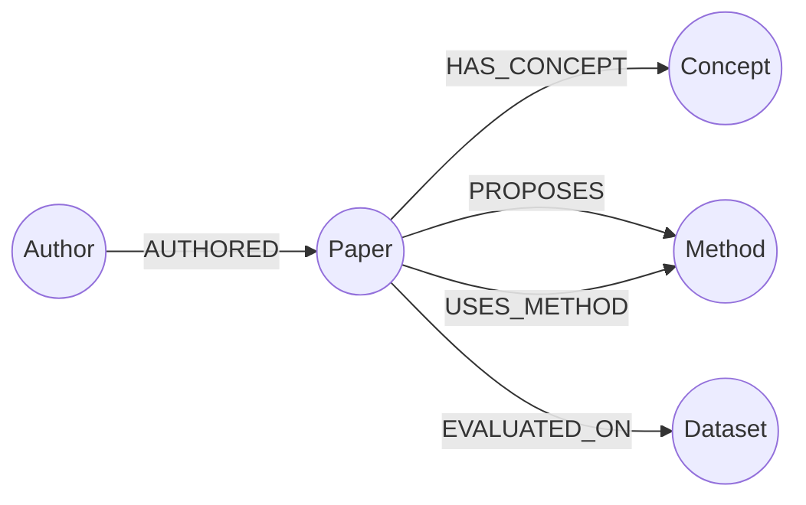

# Schema LPG e migração de entidades

O script [`schema.cypher`](schema.cypher) define cinco constraints de unicidade e
os índices RANGE, Fulltext e Vector. Compatibilidade de integração: Neo4j 5.26+;
o validador também reconhece a nomenclatura de constraints do Aura/Cypher 25.



| Label | Identidade | Origem |
|---|---|---|
| Paper | `id` | Corpus; mantém título, abstract, ano, URL e embeddings |
| Author | `entity_id` | Autores dos metadados; identidade por nome com limitação de homônimos |
| Concept | `entity_id` | Palavras-chave dos metadados |
| Method | `entity_id` | Extração com evidência no título/abstract |
| Dataset | `entity_id` | Extração com evidência no título/abstract |

Entidades mantêm `name`, `canonical_name`, `aliases` e `identity_origin`. O registro
versionado em `data/entity_registry.json` resolve aliases exatos normalizados.
Nomes diferentes não são fundidos por similaridade aproximada. IDs são estáveis
para a mesma identidade canônica; mudanças de identidade requerem migração.

Relações de metadados registram `origin`/`field`. Relações extraídas registram
origem, campo, forma de superfície, trecho literal e offsets. `PROPOSES` exige
evidência de proposta; `USES_METHOD` inclui uso/comparação/baseline. Uma menção
isolada a dataset não autoriza `EVALUATED_ON`.

| Índice/constraint | Propriedade |
|---|---|
| `paper_id_unique` | Paper.id |
| `{author,concept,method,dataset}_entity_id_unique` | entity_id do respectivo label |
| `paper_year_range` | Paper.year |
| `paper_fulltext` | Paper.title/abstract |
| `entity_name_fulltext` | Concept/Method/Dataset.name |
| `paper_embedding` | Paper.embedding, 384 dimensões, cosine |

No Neo4j 5, RANGE substitui o antigo BTree. Não recrie o índice vetorial ao trocar
somente o gerador de linguagem; a dimensão pertence ao encoder local.

## Banco existente

Não aplique apenas o novo schema sobre entidades legadas identificadas por nome.
Confira primeiro a prévia:

```bash
python -m src.migrate_entities
python -m src.migrate_entities --apply
```

Sem `--apply` não altera o banco. A migração identifica aliases, bloqueia conflitos
e backfilla IDs antes de substituir as constraints por nome. Não depende de APOC.
Dados de Paper e embeddings são preservados. Conflitos com propriedades/relações
externas impedem consolidação automática. Aliases históricos adicionais que ainda
não pertencem ao registro aparecem na prévia e exigem revisão antes de aplicar.
O próprio nome normalizado de uma entidade nova continua sendo aceito. O relatório informa o que precisa de
resolução; não force a remoção de registros para passar na validação.

Depois execute importação e indexação pelo pipeline e confira os relatórios:

```bash
python run_pipeline.py --provider curated --import-neo4j --index-embeddings
python -m src.validate_graph --check-embeddings
```

`curated` reproduz offline a referência disponível; o fluxo de produção da tarefa
usa `--provider openai` ou o padrão automático com configuração explícita.
Validação compara cada paper, entidade, direção e proveniência com a entrada.
Testes de banco usam somente `TEST_NEO4J_*` em uma instância isolada.
