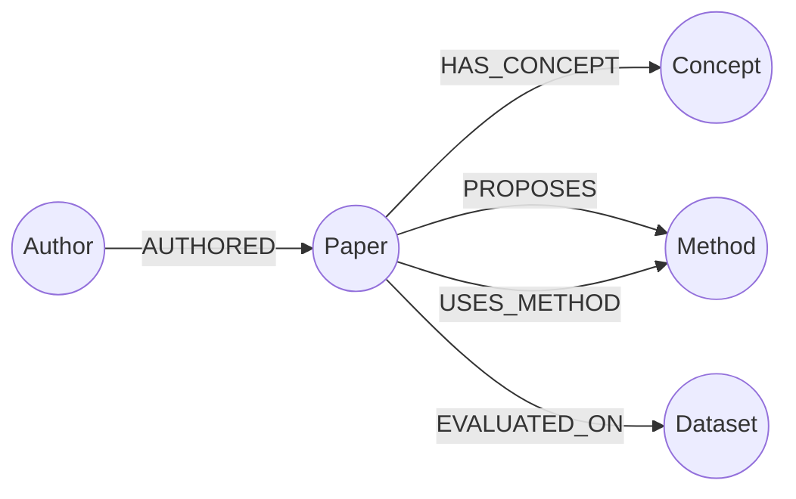

# Schema do grafo (Neo4j)

Responsável: **Gilverson Rodrigues da Silva**

Esta pasta define **como o grafo é organizado** no Neo4j: quais tipos de nós
existem, como eles se ligam, e as regras (constraints) e índices do banco.
O script completo está em [`schema.cypher`](schema.cypher).

> ✅ **Testado** em 10/11/2026 no Neo4j Desktop, versão **2026.10.2**
> (Cypher 25): os 9 comandos (5 constraints e 4 índices) executaram sem erro.

---

## 1. Desenho do grafo



## 2. Tipos de nós (Labels) e propriedades

| Label | Propriedades | Origem dos dados |
|---|---|---|
| `Paper` | `id` (único), `title`, `year`, `abstract`, `url`, `source`, `embedding`, `embedding_model`, `embedding_hash` | `data/papers.json` + indexação local de embeddings |
| `Author` | `name` (único) | campo `authors` do `papers.json` |
| `Concept` | `name` (único) | campo `keywords` do `papers.json` |
| `Method` | `name` (único) | curadoria, heurística ou extração LLM dos abstracts |
| `Dataset` | `name` (único) | curadoria, heurística ou extração LLM dos abstracts |

## 3. Tipos de relacionamento

| Relacionamento | Significado | Exemplo |
|---|---|---|
| `(Author)-[:AUTHORED]->(Paper)` | o autor escreveu o paper | autor → "LightRAG" |
| `(Paper)-[:HAS_CONCEPT]->(Concept)` | o paper trata do conceito | paper → "hybrid retrieval" |
| `(Paper)-[:PROPOSES]->(Method)` | o paper **propõe** o método | paper → "HippoRAG" |
| `(Paper)-[:USES_METHOD]->(Method)` | o paper **usa ou compara** um método de outro trabalho | paper → "GraphRAG" |
| `(Paper)-[:EVALUATED_ON]->(Dataset)` | o paper foi avaliado nesse dataset | paper → "HotpotQA" |

> A relação `CITES` (paper cita paper) ficou **fora do MVP**, porque o
> `papers.json` não tem dados de citação. Pode ser incluída depois com a
> API do Semantic Scholar.

## 4. Constraints e índices

| Tipo | Nome | Onde | Para que serve |
|---|---|---|---|
| Constraint de unicidade | `paper_id_unique` | `Paper.id` | impedir papers duplicados |
| Constraint de unicidade | `author_name_unique` | `Author.name` | impedir autores duplicados |
| Constraint de unicidade | `concept_name_unique` | `Concept.name` | impedir conceitos duplicados |
| Constraint de unicidade | `method_name_unique` | `Method.name` | impedir métodos duplicados |
| Constraint de unicidade | `dataset_name_unique` | `Dataset.name` | impedir datasets duplicados |
| Range (antigo "BTree") | `paper_year_range` | `Paper.year` | filtrar papers por ano |
| Fulltext | `paper_fulltext` | `Paper.title`, `Paper.abstract` | busca por palavras |
| Fulltext | `entity_name_fulltext` | `name` de `Concept`, `Method`, `Dataset` | achar entidades pelo nome |
| Vetorial | `paper_embedding` | `Paper.embedding` | busca por significado (cosseno) |

**Observações:**

- No Neo4j 5 o índice **BTREE foi removido** e substituído pelo índice
  **RANGE**, que é o tipo padrão do `CREATE INDEX`. Por isso o requisito
  "BTree" do enunciado é atendido pelo `paper_year_range` e pelos índices
  criados automaticamente pelas constraints de unicidade.
- O índice vetorial está configurado com **384 dimensões**. Esse número
  precisa ser igual ao tamanho do embedding do modelo escolhido na busca
  híbrida (ex.: `all-MiniLM-L6-v2` = 384; OpenAI `text-embedding-3-small`
  = 1536). Se o modelo mudar, o índice deve ser apagado
  (`DROP INDEX paper_embedding`) e criado de novo com o valor certo.
- Autores são identificados pelo **nome**. Dois autores diferentes com o
  mesmo nome virariam um único nó; é uma simplificação aceita no MVP.

## 5. Como aplicar o schema

O fluxo automático recomendado é
`python run_pipeline.py --provider curated --import-neo4j --index-embeddings`.
Ele aplica o schema, aguarda os índices e valida sua definição, além dos dados
e embeddings. Os passos abaixo são a alternativa manual. A interface apenas
consulta o banco e não altera o schema.

O validador aceita a identificação `UNIQUENESS` do Cypher 5 e
`NODE_PROPERTY_UNIQUENESS` do Cypher 25 para as mesmas constraints de nós,
conforme a [documentação do Neo4j](https://neo4j.com/docs/cypher-manual/5/constraints/list-constraints/).

1. Abra o banco Neo4j do grupo (AuraDB Free ou Neo4j Desktop).
2. Abra a ferramenta de consulta (**Query** no Aura, ou **Neo4j Browser**).
3. Copie todo o conteúdo de `schema.cypher`, cole e execute.
4. Confira o resultado:

```cypher
SHOW CONSTRAINTS;
SHOW INDEXES;
```

Devem aparecer as **5 constraints** e os índices `paper_year_range`,
`paper_fulltext`, `entity_name_fulltext` e `paper_embedding` (além dos
índices criados automaticamente pelas constraints). O índice vetorial pode
aparecer como `POPULATING` por alguns instantes antes de ficar `ONLINE`.

## 6. Teste rápido da constraint (opcional)

```cypher
// 1) Cria um paper de teste
CREATE (:Paper {id: 'teste-123', title: 'Paper de teste'});

// 2) Tenta criar outro com o MESMO id -> deve dar ERRO (constraint funcionando)
CREATE (:Paper {id: 'teste-123', title: 'Duplicado'});

// 3) Apaga o paper de teste
MATCH (p:Paper {id: 'teste-123'}) DELETE p;
```

## 7. Exemplo de consulta multi-hop que o schema permite

"Quais conceitos aparecem nos papers dos autores que escreveram sobre KAG?"

```cypher
MATCH (c1:Concept {name: 'KAG'})<-[:HAS_CONCEPT]-(:Paper)<-[:AUTHORED]-(a:Author)
      -[:AUTHORED]->(p:Paper)-[:HAS_CONCEPT]->(c2:Concept)
RETURN a.name, p.title, collect(DISTINCT c2.name) AS conceitos;
```
